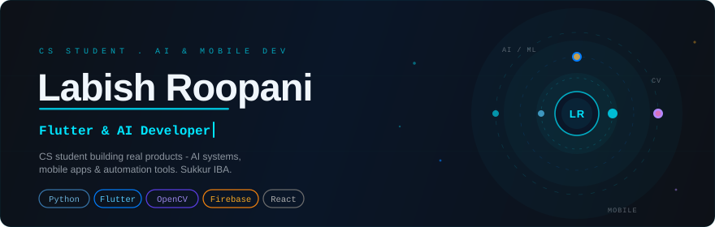

 

---

## About

CS student at **Sukkur IBA University** building real products — AI systems, mobile apps, and automation tools. Passionate about intelligent solutions and pursuing a career in AI & Data Science.

I build at the point where machine learning stops being a lab experiment and starts being something a person can actually use. I've shipped facial recognition security systems, gesture-based controllers, AI automation agents, and Flutter apps for real clients — not just demos.

Motivated by the gap between "it works in a notebook" and "it works in the real world." That gap is where most of the actual engineering happens, and it's where I want to be.

---

## What I Build

<table>
<tr>
<td width="50%" valign="top">

### 🤖 AI & Automation
Building AI agents, NLP pipelines, and intelligent workflow tools in Python. AI APIs, prompt engineering, and automating repetitive tasks so humans don't have to.

</td>
<td width="50%" valign="top">

### 👁️ Computer Vision
Real-time facial recognition, gesture-based controllers, and ML-powered detection systems. Local inference — no cloud round-trip, no latency.

</td>
</tr>
<tr>
<td width="50%" valign="top">

### 📱 Mobile Apps
Flutter + Firebase applications for real clients — from mood journals and mental health trackers to tailor management systems and game apps. End-to-end: UI design, database, deployment.

</td>
<td width="50%" valign="top">

### ⚡ Developer Tools
AI-powered code suggestion tools, Excel automation agents, and Python scripts that make workflows faster and smarter.

</td>
</tr>
</table>

---

## Featured Work

<table>
<tr>
<td width="50%" valign="top">

### 🔐 Smart Door Camera System

ML-based facial recognition security system integrated with a Flutter mobile app for real-time monitoring and instant push notifications.

**Solves** the need for an intelligent home security system with mobile remote access.  
**Notable** end-to-end CV + mobile solution — Python ML backend communicates with Flutter app via Firebase in real time.

`Stack` &nbsp;   

</td>
<td width="50%" valign="top">

### 👋 AirPointer — YouTube Gesture Controller

Real-time gesture-based YouTube control using OpenCV and MediaPipe. Sub-100ms response time with fully touchless interaction — no keyboard or mouse required.

**Solves** the friction of controlling media while hands are occupied or dirty.  
**Notable** sub-100ms latency — runs entirely locally with no server dependency.

`Stack` &nbsp;  

</td>
</tr>
<tr>
<td width="50%" valign="top">

### 🤖 AI Sales Agent

AI-powered sales assistant that automates customer interactions using intelligent NLP-based response handling — automating repetitive sales queries and improving response efficiency significantly.

**Solves** the bottleneck of manual, repetitive customer query handling at scale.  
**Notable** prompt-engineered response system integrated via AI APIs for context-aware replies.

`Stack` &nbsp;  

</td>
<td width="50%" valign="top">

### 📊 AI Excel Agent

AI-powered system to manage Excel data using natural language — dynamic add, update, delete, and search through plain text commands. Built during Python internship at CodeAlpha.

**Solves** the slow, error-prone process of manual spreadsheet management.  
**Notable** natural language → structured data operations using NLP — no formula knowledge required.

`Stack` &nbsp;  

</td>
</tr>
<tr>
<td width="50%" valign="top">

### ✂️ Tailor Management System

Flutter + Firebase mobile app built for a local tailoring business — order tracking, customer records, and digital measurements with real-time sync. Live freelance project.

**Solves** the chaos of paper-based order management in small tailoring businesses.  
**Notable** real client, real deployment — 100% custom UI and database architecture.

`Stack` &nbsp;  

</td>
<td width="50%" valign="top">

### 🌙 Aura — Mood Journal App

Mental health and wellness mobile application that tracks and analyzes daily mood patterns. Integrates mood logging, daily streaks, customizable notes, and detailed visual analytics.

**Solves** the lack of accessible, private tools for personal mental well-being tracking.  
**Notable** full offline-first architecture with local DB — no account required, full privacy.

`Stack` &nbsp;  

</td>
</tr>
<tr>
<td width="50%" valign="top">

### 🖐️ Hand Stress Pro

Real-time stress detection mobile app that analyzes hand motion and gestures using an ML model — with local history tracking, custom settings, and gesture analytics.

**Solves** the difficulty of quickly detecting physical stress indicators in real time.  
**Notable** ML model running on-device — low latency, no network dependency.

`Stack` &nbsp;  

</td>
<td width="50%" valign="top">

### 🎮 Sloppy Rush — Mobile Game

Mobile game built in Unity with physics-based mechanics, level design, and a polished UI — a complete, playable game loop from scratch.

**Solves** nothing serious — this one was about learning game architecture and shipping something complete.  
**Notable** physics engine, level progression, and full game loop in a single solo project.

`Stack` &nbsp; 

</td>
</tr>
</table>

---

## Tech Stack

| Layer | Technologies |
|-------|-------------|
| **Languages** | Python · Dart · C++ · Java · React Native |
| **Mobile** | Flutter · Firebase Realtime DB · Android Studio |
| **AI / CV** | OpenCV · MediaPipe · ML Models · AI APIs · NLP · PyAutoGUI |
| **Web** | React · HTML · CSS · Figma |
| **Database** | MySQL · PostgreSQL · Firebase |
| **Tools** | Git · GitHub · VS Code · Jupyter Notebook · Vercel |

---

## Experience

**🤖 AI Development & Automation Intern** · iHunar Private Limited · `Jul 2026 – Aug 2026`
> Gained hands-on experience in AI development, workflow automation, Python scripting, AI API integration, and prompt engineering. Built automated AI workflows, integrated intelligent AI APIs into Python applications, and applied prompt engineering to optimize system responses.

**💼 Freelance Software Engineer** · Independent · `2024 – Present`
> End-to-end software development for clients — mobile and full-stack applications, from UI/UX design and database architecture to final deployment. Developed and deployed 6+ custom applications including Aura and the Tailor Management System. Designed responsive interfaces and structured Firebase architectures.

---

## Education

| Degree | Institution | Period |
|--------|------------|--------|
| 🎓 BS Computer Science | Sukkur IBA University | Aug 2023 – Present |
| 📘 Intermediate (Pre-Engineering) | Shah Abdul Latif Degree College | 2020 – 2022 |
| 📗 Matriculation (Science) | The Stepping Stone High School | 2018 – 2022 |

**Certifications:**
- ✅ AI Development & Automation Internship Certificate — *iHunar Pvt Ltd, Aug 2026*
- ✅ Mastering Deep Learning for Generative AI — *Udemy, Nov 2025*
- ✅ Introduction to Neural Networks — *Great Learning Academy, Jun 2024*
- ✅ Basics of Data Structures & Algorithms — *Simplilearn, Jun 2024*
- ✅ Mobile App Development (Android) — *Simplilearn, Apr 2024*
- ✅ Java Programming for Beginners — *Simplilearn, Feb 2024*

---

## How I Work

**Start from the problem, not the technology.** The stack is a consequence of what needs to be built, not the other way around.

**AI earns its place when it does something ordinary code can't.** Everywhere else, clean Python is faster, cheaper, and easier to debug.

**A model in a notebook is not a product.** Training is the easy half. Getting it into something with a real UI, error states, and an actual user — that's where the real engineering is.

**Ship to real clients, not just portfolios.** Real users find real edge cases. That's the only feedback that matters.

**Write code the next person can read.** That person is usually me, three months later, with no memory of why any of it made sense.

---

## GitHub Activity

---

## Currently

| 🏗️ Building | 🔭 Exploring | 📚 Sharpening |
|------------|------------|--------------|
| AI automation agents and intelligent Python tools for real-world workflows | Advanced deep learning, generative AI, and LLM integration with production systems | DSA, system design, and React Native for cross-platform mobile development |

---

## Languages

🗣️ **English** — Fluent &nbsp;|&nbsp; **Urdu** — Proficient &nbsp;|&nbsp; **Sindhi** — Native

---

## Let's Build Something

I'm open to **internship opportunities**, **freelance projects**, and **collaborative AI/mobile work** — particularly anything where intelligent systems meet real users.

If you have an idea worth building, or a problem worth solving — **get in touch.**

 

&nbsp;&nbsp;
&nbsp;&nbsp;

 

> *Build. Learn. Ship. Repeat.*

---

